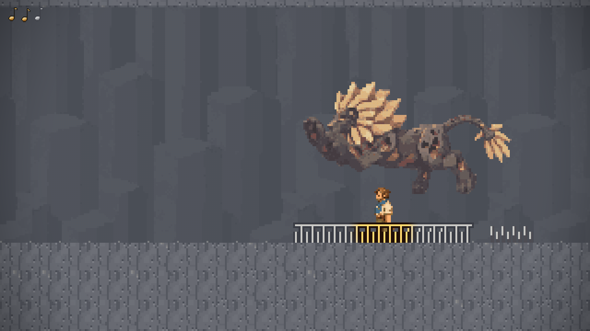

## Summary

The ember spit lands 3 patches 96 px apart, the middle one on Ivo's spot, and each burns 1.5 s. Ivo steps into a 48 px
gap. The next move's wind-up starts as the patches land, so it is thrown while they burn. If that move is the pounce slam
(stage 1), its 190 px shadow is centred on Ivo and covers both neighbouring patches. The patches outlive the landing box
(0.75-1.0 s into the strike). `systems/guardians` answers the pounce with "walk out of the shadow away from the lion,
then jump the embers". That needs walking through a burning patch, so the answer is gone. A single jump out over the
patch works only at some press times. Too early, he lands as the landing-ember runner reaches him; too late, the
descending body hits him.

## Symptom

GRD-16 feel playtest, 2026-11-19 (`playtests/2026-11-19-grd16-sun-feel`; median frame time 5-6 ms in every run).

- Natural play: in `o1` (t 45.19) and `l1` (t 102.89, the killing hit), the pounce came right after a spit. Ivo stood in
  the gap, with patches at -44 and +52 px inside the shadow, and was hit by the landing body.
  
- Across the session's four fight runs, 2 of 9 pounces followed a spit. Of the 44 strings that followed a spit (these
  runs plus the implementer's `pl7`, `pl10`, `pl11`), 43 began their wind-up with Ivo boxed between two burning patches.
- Forced probe `pt1`: a scratch driver set `GuardianAI._next` to spit, then pounce, 20 times. With god mode, Ivo jumped
  away from the lion over the patch at a swept time into the strike (`pj`), with the direction held, and then jumped the
  landing embers.

  | jump at (s into the strike) | hit / tries | by |
  |---|---|---|
  | 0.0 | 0 / 4 | - |
  | 0.12 | 2 / 4 | landing-ember runner, as Ivo lands (y 8-15 px above the floor) |
  | 0.22 | 2 / 3 | landing-ember runner, as Ivo lands |
  | 0.3 | 0 / 3 | - |
  | 0.4 | 0 / 3 | - |
  | 0.5 | 2 / 3 | the descending body (`hb=false`, 38-49 px up) |

  Every clean try at 0.12, 0.22 and 0.5 s (four) ended against the arena's east wall (x 3796.9), where the jump was cut
  short and the landing clamped. Away from a wall, every jump at 0.12-0.22 s or 0.5 s was hit.

## Root cause

The pounce test (`test_the_pounce_shadow_covers_its_reach_and_can_be_walked_out_of`) checks the walk-out on an empty
floor. The spit's timings guarantee the overlap:

- Patches land 1.2-1.4 s into the spit's strike and burn until 2.7-2.9 s.
- The next telegraph starts about 1.4-1.6 s in (strike 0.5, recovery 0.4, cooldown 0.7 x 0.7 at stage 1).
- The pounce's box is live 1.25-1.5 s after its telegraph starts, which is 2.65-3.1 s into the spit.

The landing-ember runner (`ember_burst.tscn`: 128 px at 320 px/s from 72 px off the landing) covers exactly where a jump
over the near patch comes down.

## Fix

Fixed 2026-11-19 (GRD-16 feel round), the first option, made generic: `GuardianAttack.waits_for_floor`. A move whose
dodge crosses the floor is left out of every pick while the guardian's own floor burns (`GuardianSpawner.floor_burning()`:
a live `FloorPatch`, or a `Lob` in flight that will leave one), and a move already chosen is re-picked. The Sun's pounce
slam, roar and sun shafts wait; the claw and the charge, both jumped, come instead, so the lion stays busy.

Tests: `guardian_ai_test.test_a_move_that_waits_for_the_floor_is_held_while_it_burns`,
`summer_guardian_kit_test.test_the_floor_moves_wait_for_the_embers_to_burn_out`. In play: a forced spit-then-pounce run
(`PL_FORCE_SEQ`, `playtests/2026-11-19-grd16-sun-fight`) forced spit, then pounce, 11 times (Orchard kit, god mode, 6 ms a frame): the gate put a charge or a claw between them every time, all 11 pounces wound up with no live patch, and none hit.

## Prevention

A move's dodge test has to be run with the floor the previous move leaves behind. For every pair (A, B) where A leaves a
hazard that is live when B's hit opens, B's documented answer must still be valid.
