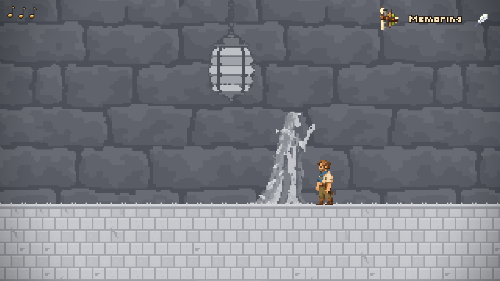
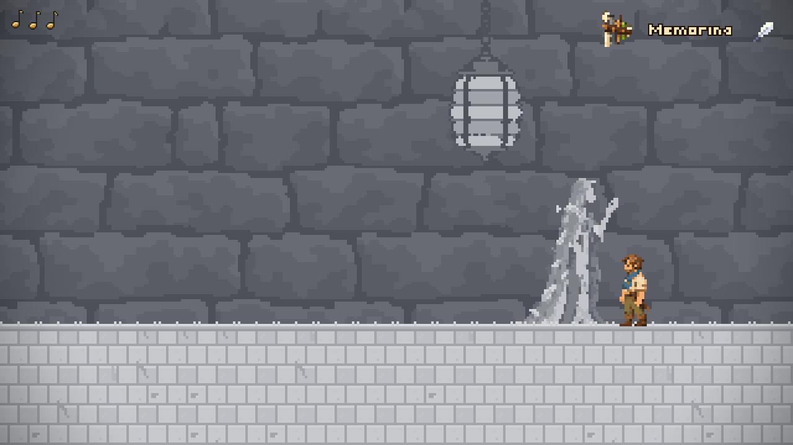
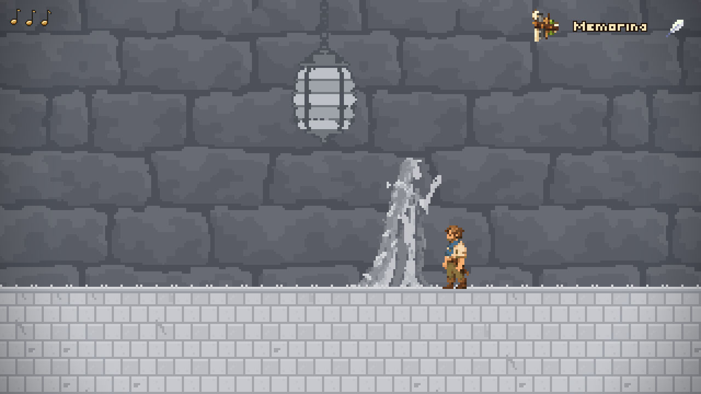
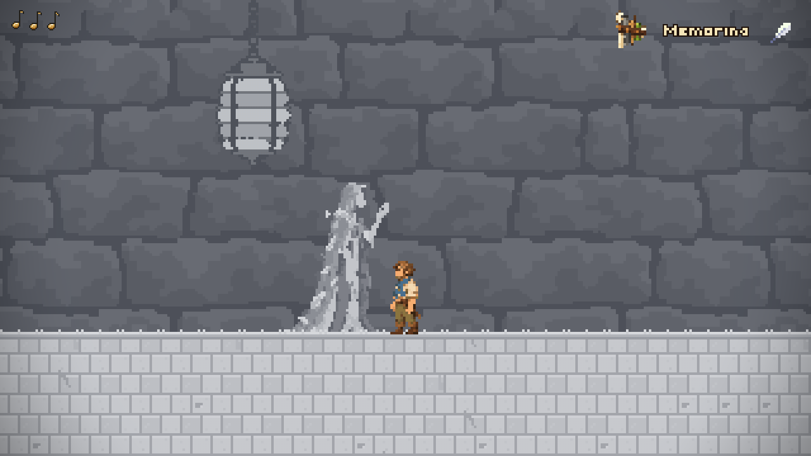

## Summary

**Pass on the second fix (camera.gd 08:48:50).** The largest per-frame step from control return to +2 s:
- mentor lantern release: **2.68 px** in each of 2 runs;
- `mentor_wakes` hand-back: **4.52 px**.

The mentor frame eases onto Ivo plus his lead (11560) and rests there. `mentor_wakes` now lands on 11608 with no dip.

The first fix (08:31:07) failed. It removed the original permanent 96 px cut, but left a one-frame 96 px flick on the
hand-back step (11560 → 11464 → 11560, 2/2 runs, drawn). The second fix shifts `global_position.x` by the offset change in
`follow()`, which removes the flick
(`bugs/the-rig-hand-back-shows-the-seeded-look-ahead-one-frame-before-the-frame-follows-ivo`, now fixed). The same change
removes the pre-existing 6.4 px out-and-back of `mentor_wakes`.

The first-fix controls were identical on HEAD: elder talk 3.05 px, opening morning 4.82 px.

## Details

### Method

- `talk_reader_driver.gd` with `CAMLOG=1` (one `[cam]` line per rendered frame on any change of
  `get_screen_center_position()` or zoom), reading pace `READ` 1.0 s. Setups:
  - `story37_mentor_talk_setup.json` for the mentor;
  - the elder's `story16_elder.json` reduced to its walk-in (scratch copy), so the driver's own Z presses do not double
    up;
  - the opening morning's `story16_morning.json` with only `log` steps 20-29 s;
  - `story38_keeper_wakes.json` unchanged.
- Window: from "talk ended, unblocked" (`PlayerInput.blocked` false), or the cutscene's `blocked=false` log, to +2 s.
  Steps between consecutive `[cam]` lines. At 180 Hz render and 60 Hz physics a line comes every 3 process frames, so
  each step is one physics step.
- Each run went on the working tree and on a `git archive HEAD` export (`APPDATA` redirected to a fresh scratch folder per run, checked with a headless `OS.get_user_data_dir()` probe).
- A scratch copy of the driver saved the next 5 frames whenever the centre moved more than 40 px in one frame, to prove a
  logged spike was drawn.

### Mentor talk (`mentor_gift` → `mentor_silence` → control), Ivo still at x 11656 facing west

| Build | Control back | Ease | Largest step in [return, +2 s] | Rest |
|---|---|---|---|---|
| HEAD | t 40.61 | 11600/-1308 z 1.98 → 11559.99/-1331.92 z 1.0 by t 41.40 | **96.01 px** (t 41.415, 11559.99 → 11656.00, permanent) | 11656 (no lead) |
| First fix, run 1 | t 40.65 | same curve, ≤2.7 px per step | **96.04 px out, 96.01 px back** (t 41.429: 11560.03 → 11463.99 → 11560.00) | 11560 (lead kept) |
| First fix, run 2 (spike capture) | t 40.65 | same | **96.04 / 96.01 px** (t 41.429 / 41.434) | 11560 |
| First fix, run 3 (PNG every frame, ~25 fps) | t 40.6 | same, ≤6.4 px per frame (several physics steps per frame) | 6.38 px: no flick drawn | 11560 |

The ease itself is clean: every step before the flick is ≤ 2.7 px per physics step, and the zoom goes 1.98 → 1.0
smoothly in ~0.75 s.

Screenshots (window px, Ivo's sprite columns at row 500):
- Fix:
  - `fixed_1_eased_to_lead.png`: Ivo at 816..855;
  - `fixed_2_one_frame_flicker.png`: 1008..1047, the frame shifted 96 game px for one frame;
  - `fixed_3_back_on_lead.png`: 816..855.
- HEAD:
  - `head_1_eased_to_lead.png`: 816..855;
  - `head_2_cut_onto_ivo.png`: 624..663, and it stays there.

Mechanism (from code plus log, see the bug):
1. `CutsceneDirector._tick_return` lands the rig on `centre_for(ivo) - offset` (offset x 0 under the rig) after the
   camera's physics step.
2. It then calls `follow(ivo)`, whose seeded `_look_ahead = -96` writes `offset.x` at once while `global_position` is still
   the rig's.
3. The next camera step moves the position onto Ivo and the centre returns to 11560.

### Second fix (camera.gd 08:48:50): re-run

`follow()` now shifts `global_position.x` by the offset change after seeding the look-ahead. Same drivers and setups,
normal frame rate, spike capture armed:

| Case | Run | Control back | Largest step, return → +2 s | Rest | Spike (>40 px) |
|---|---|---|---|---|---|
| Mentor release | 1 | t 40.66 | **2.68 px** (t 41.120, during the zoom ease) | 11560.00 / -1332.00 | none |
| Mentor release | 2 | t 40.65 | **2.68 px** (t 41.100) | 11560.00 / -1332.00 | none |
| `mentor_wakes` hand-back | 1 | t 7.22 | **4.52 px** (t 7.483, the rig's ease) | 11608.00, through 11608.36 → 11608.09 → 11608.00 | none |

The `mentor_wakes` hit shake at t 10.4 (8.8 px) is outside the window and expected.

### Controls (a talk-with-zoom release and two cutscene hand-backs)

| Case | Build | Largest step, return → +2 s | Notes |
|---|---|---|---|
| Elder talk (`elder_story`, zoom 2 → 1), Ivo x 5109 | fix | 3.05 px (t 34.211) | identical to HEAD |
| | HEAD | 3.05 px (t 34.185) | rests at 5120/12204 (room clamp) |
| Opening morning cutscene hand-back (zoom ~1.2 → 1), village_house | fix | 4.82 px (t 22.269) | one-screen room: the lead is clamped, so this case cannot show the flick |
| | HEAD | 4.82 px (t 22.268) | identical |
| `mentor_wakes` hand-back into the fight (paired with the guardian) | fix | 6.41 px then 6.05 px back (t 7.882 → 7.899: 11608.36 → 11601.95 → 11608.00) | same out-and-back signature, small |
| | HEAD | 6.41 / 6.05 px (t 7.890 / 7.905) | identical: pre-existing, not caused by STORY-39 |

The ~7.5-11 px steps at t ~10.4 in `mentor_wakes` are the hit shake when the guardian strikes the still Ivo (expected).

No new step appears in any control. The fix changes nothing measurable outside the mentor release.

### The STORY-39 test (first fix)

`camera_test.gd` `test_a_talk_released_under_a_rig_hands_back_without_a_step` passes while play shows the flick. It
presumably samples only after full camera steps. A test that reads the screen centre right after `follow()` would catch it.

## What screenshots and logs cannot show

- Whether the release feels smooth. Fluidity 4 is inferred from the numbers on the second fix: every step ≤ 2.7 px
  during an even ~0.75 s ease. Nobody watched or felt it, so a human should confirm. The first fix's 16.7 ms flick
  would have been a single drawn frame.
- On a machine where render and physics do not interleave 1:1, the flick may draw on more or fewer frames. At low frame
  rates it does not draw at all (run 3).
- Audio and input latency were not judged.

## Gotchas / pitfalls

- A per-frame camera log taken while saving a PNG every frame hides one-physics-step states: several physics steps run
  between two draws. Use the log-only run for numbers and a capture-on-spike driver to prove a frame was drawn.
- The first `mentor_wakes` run on the fix stopped Ivo at x 12017 (held `move_left` released by a focus change) and never
  entered the zone. The re-run worked. Check `pos` before reading a "no step" result.
