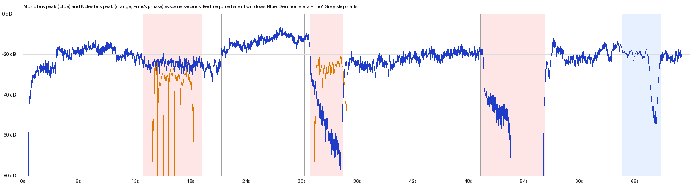

# STORY-43: the final fragment's underscore

**Verdict: in sync, with no drift.** The music clock stays within about 10 ms of the scene clock for the whole
71.25 s. A pause holds both clocks and leaves a constant +16 ms after it. A skip fades the music over 0.8 s, and
`finale_restoration` starts ~3 s after the fragment ends in every path. Panel 4's collision and panel 6 are silent as
planned. Panel 2 is not silent: a low pedal plays under Ermo's phrase, and the plan allows that. Three authored
entries come 0.15-0.4 s before the step they belong to. Those are timing notes, not defects.

Sound was not heard. Everything below comes from logged clocks and bus meters. Timbre, balance, and whether the
pedal under panel 2 masks the flute need a human listen.

## Setup

- A scratch `-s` driver around the runner, `s43/drv.gd`. Each rendered frame it prints:
  - scene seconds, summed from a PAUSABLE physics node from `scene_began`;
  - `Music.position()` and every deck (cue, position, `volume_db`, gain, ringing, paused);
  - the Music and Notes bus peak dB;
  - the Music bus spectrum: 255-400 Hz (C4-G4), 60-250 and 420-4000 Hz, from an `AudioEffectSpectrumAnalyzer` the
    driver adds at run time;
  - `Fade` alpha.
- On change it prints every step start (`step.resource_path` gives the sub-resource id), every `MelodyPlayer.note_played`
  and every panel or caption turn. `KEYS` sends raw keys at real seconds after the scene starts.
- Seed: `world_restored`, the four restored, `scenes_seen: ["mentor_wakes"]`, spawn (12048, -1254), `"clock": "real"`.
  `FinalFragment` started at real 0.8 s.
- Three runs:
  - `a`: plain;
  - `p`: Escape at 25 s and again at 29 s;
  - `k`: Escape, Down, Z at 40-41.2 s (Skip scene).
- `APPDATA` was redirected per run. The driver printed the scratch dir as `OS.get_user_data_dir()`. The real save and
  settings had the same md5 before and after.
- No screenshots: the frame hitches they cause would spoil the timing. The one image is an envelope plot built from
  the log.

## Offsets (run `a`; off = music position - scene seconds)

| Point | Scene s (step start) | Music s | Offset |
|---|---|---|---|
| Panel 1 | 3.4000 | 3.4046 | +4.6 ms |
| Panel 2 | 12.4000 | 12.4082 | +8.2 ms |
| Panel 2, first phrase note (G) | 13.9167 | 13.9117 | -5.0 ms |
| Panel 3 | 21.4000 | 21.4001 | +0.1 ms |
| Panel 4 | 30.4000 | 30.4007 | +0.7 ms |
| Panel 4, `break_winter` note 1 | 31.4000 | 31.4050 | +5.0 ms |
| Panel 4, `break_spring` note 1 | 31.7167 | 31.7127 | -4.0 ms |
| Panel 7 | 56.4333 | 56.4390 | +5.7 ms |
| "Seu nome era Ermo." shows | 65.1000 | 65.0884 | -11.6 ms |
| Clear | 68.9333 | 68.9197 | -13.6 ms |

- **No drift.** The mean offset per 6 s window is +3 to +6 ms from 0 to 66 s, and +0.4 ms in the last window. Every
  frame lies within -18 to +27 ms. That spread is the mix-chunk granularity of `get_playback_position()`, not motion.
  Scene seconds vs wall clock stays within ±20 ms. The engine's output latency is 10 ms, and it shifts both clocks
  the same way.
- **The steps run late against their nominal sum.** Each step boundary rounds up to the next physics tick, so panel 5
  starts at 37.4167, panel 7 at 56.4333, the clear at 68.9333 and `to_black` at 70.45 (nominal 37.4 / 56.4 / 68.9 /
  70.4). By the end that is +33 to +50 ms, the same in every run. The music follows the wall clock, so the late
  steps account for most of the lead in the next section.
- **Frame stalls:** one frame of 36-44 ms at panel 1's start (s 3.43-3.45) in every run, likely the first panel's
  textures. No other frame over 25 ms during the scene. The offset just after it was still +4.6 ms.

## Silent windows (Music bus peak, run `a`; see `bus_envelope.png`)

- **Panel 2, his phrase (13.0-19.3): the bus is not silent.** It holds -19 to -29 dB peak, median -24.7. That is
  level with the phrase's own Notes peaks (-24 to -30). The C4-G4 band stays 18-25 dB below the bus peak (max -43,
  median -48) and shows no rise at any of the six note onsets, so no new mid-register note was measured. This fits
  the plan ("low A only under his phrase"). The overtones of a low A fall inside 255-400 Hz, so the band reading
  cannot rule out a note on its own. **Needs a human ear:** is a pedal at the flute's peak level too loud under it?
- **Panel 3's cut: on time.** The bus is -11 dB at 30.78, -15 at 30.90, -20 at 31.00, then decays: -35 at 31.3
  (the collision's first note, 31.40) and below -60 by 33.0. No onset in 31.0-34.4. The Bb re-entry starts at about
  34.46 (-61.7 dB, then -40 at 34.56), about 40 ms before the 34.5 limit. The last spring note still rings on Notes at
  -26 dB then, which the plan allows.
- **Panel 6 (49.4-56.4): no new note.** The fourths caught on panel 5 decay from -19 dB at 49.6 through -36 to -55 dB
  until 52.8. From 52.85 to 56.2 the bus is at true digital silence (-200).
- **Panel 7 entry: leads its step by about 0.15-0.2 s.** The music rises from 56.22 (-59 dB) to -33.6 by 56.40. The
  panel_7 step starts at 56.433, while panel 6's dissolve still shows.
- **The name:** at ~64.9-65.0 the low band drops from -36 to -55..-68 dB, while the bus holds -18 to -20 dB and the C4-G4
  band -36. That reads as one held mid voice, consistent with "the flute alone", and it lines up with the name
  (65.10). It is followed by a near-silence (-45 to -56 dB) from ~67.8 to 68.5.
- **The closing Am: about 0.4 s before the clear.** The onset is at about 68.50-68.55 (-50 to -41 dB), -21 dB by
  68.84. The clear step starts at 68.933, so the chord lands while "Seu nome era Ermo." is still up. If the chord is
  meant to arrive with the clear, move it about 0.4 s later in the score, or start it at 68.93 to match the measured
  step.

## End of the scene and the restoration cue (run `a`)

- The fragment ends at scene 71.25. `CutsceneMusic(null, -1)` releases the request, and the deck **rings** (`R`) at
  -6.3 dB with no fade until its file ends at 74.07. `fade_out` 0.8 is not applied on a normal end, by design
  (`Music._retire`: a one-shot released with -1 plays to its end).
- The audible tail falls from -20 dB at 71.2 to -45 at 71.84 and -55 by 72.2. It ends under the restoration's
  opening black, which is opaque until 72.45. The stream holds near -60 dB until it ends at 74.07.
- **`finale_restoration` starts at real 74.26**, 3.0 s after the fragment ends and 0.19 s after the fragment's deck
  stops, with no overlap. It plays at -8.9 dB, gain 1, together with the restoration's `melody_12`. The restoration
  then runs to 85.42, and `mentor_approach` plays after it, as in STORY-42.

## Pause (run `p`)

- Escape at scene 25.000 (panel 3): the tree pauses, the deck's `stream_paused` holds it, and the bus reads -200 dB
  within one frame. The scene clock stops at 25.000.
- Escape at real 29.00 closes the menu. The deck resumes at 25.057 while the scene clock reads 25.033, so it picked up
  where it stopped.
- After the pause the mean offset is **+20 ms** (+4 ms before it) and stays there to the end (+20.0 ms in every
  window from 42 to 72 s). One pause costs ~16 ms, one frame, and nothing more. Panel 4's notes after the pause were
  +3 to +22 ms off the music clock.
- Note: `Music.position()` reads 0 while the deck is paused, because `player.playing` is false under
  `stream_paused`. Nothing in this scene reads it during a hold. A `CutsceneMusicMark` waiting through a `Music.hush()`
  (a performance freeze) would also read 0. That is not filed: no scene does it today.

## Skip (run `k`)

- Pause menu at 40.0 (panel 5), Down, then Z at real 41.20: the fragment ends at 41.215 and `world_restoration`
  begins in the same frame, on black (the `Fade` cuts to 1.00).
- **The music fades:** deck gain falls linearly 0.98 → 0.09 from 41.22 to 41.94 (`volume_db` -6.5 → -27.1), then the
  deck stops by 42.04. That is `SKIP_MUSIC_FADE` 0.8 s.
- `finale_restoration` starts at 44.29, 3.07 s after the skip, as on the full path. Nothing overlaps.

## What this cannot judge

- Whether the cue sounds good, whether the pedal under panel 2 masks his flute, or whether the lone voice under the
  name is a flute: bus peaks and three spectrum bands cannot tell instruments apart.
- Perceived sync: the offsets are mix-time positions. Output latency (10 ms) adds the same amount to the music and to
  the note steps (both are AudioStreamPlayers), so they stay in step. What the screen shows against what is heard also
  depends on display latency, which was not measured.
- Bus peaks are smoothed, so the onset times above are good to about ±30-50 ms.

## Harness notes

- An `AudioEffectSpectrumAnalyzer` added to the Music bus by the driver gives per-frame band levels without touching
  game code. `MAGNITUDE_MAX` over 255-400 Hz checked "nothing between C4 and G4". A low pedal's overtones fall in that
  band too, so look for a rise at an onset, not an absolute level.
- `step.resource_path` of a sub-resource step is `res://...tres::<id>`, so the `.tres` id names each step in the log.
- A PAUSABLE node summing `_physics_process` delta from `scene_began` is the scene clock. It matches the director's
  own tick to a frame.
