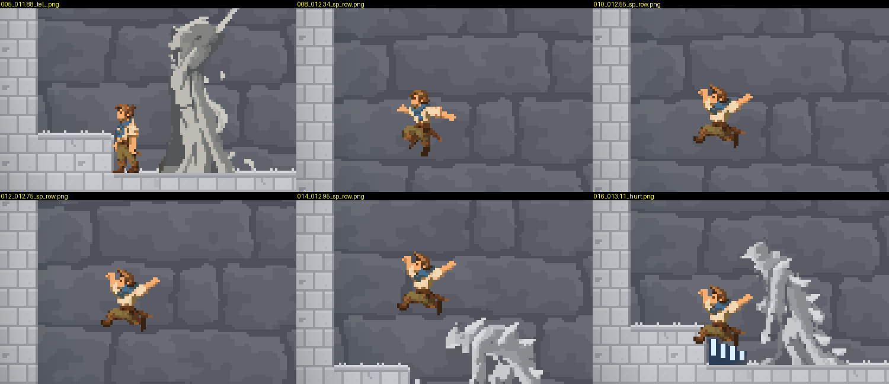
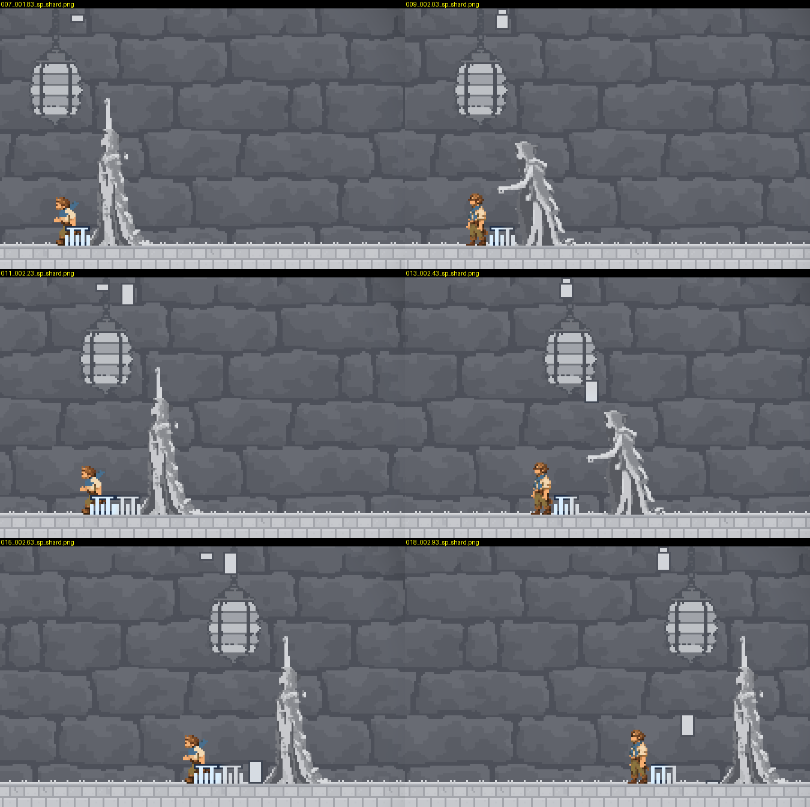
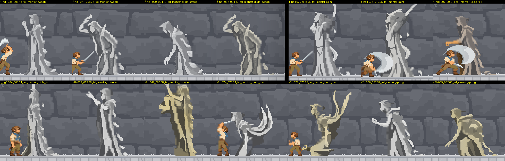
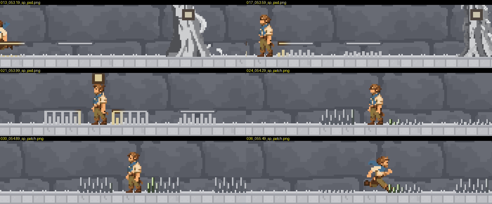
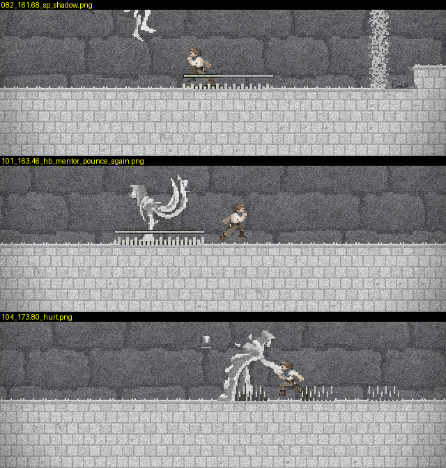
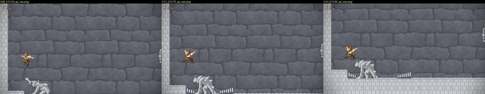

## What was tested

This pass is independent of the implementer's `2026-11-19-grd17-mentor-fight`. Runs went one window at a time. The run
script refused to start while any Godot process was running. It pointed `APPDATA` at a fresh scratch folder per run and
checked that with a headless `OS.get_user_data_dir()` probe first. **Every run's median frame time was 5-6 ms** (`[frame]`,
max of the medians 6), so no run was discarded. Timeline: `guardian_bot_mentor.json`'s setup (the four restored,
`mentor_wakes` seen, skills 0-2, all songs), cut to 75, 200 and 420 s.

Driver: a session copy of `guardian_fight_player_driver.gd` (scratchpad `feel17/drv.gd`, policy unchanged) with these additions:
- `[idle]`: every 0.1 s between moves, the AI's clock phase, `_next`, in range, held by the floor, floor burning, Ivo
  overhead, escape, spacing mode, far pick, dx.
- `[tr]`: a per-frame trace for 1.6 s after each hit, with i-frames.
- `FV_STAGE` forces the AI's stage tuning (labelled "forced").
- `FV_HAIL=stand|smart|plan|jump|jump2` and `FV_SLAM=stand|jump|djump|jumpE` throw a hail or a slam from `FV_D` px at an
  Ivo pinned on a floor's wall. They write `GuardianAI._next` and zero `comfort_distance`.

| run | policy | result |
|---|---|---|
| `f_ng1` | dodging, no god | died 58.2 s, stage 1. Ice wave parked at the west step, then contact 0.9 s later, then an icicle |
| `f_ng2` | dodging, no god | **restored 110.3 s, 0 hits** |
| `f_ng3` | dodging, no god | **restored 119.1 s, 0 hits** |
| `f_ng4` | dodging, no god | died 100.3 s, stage 2. Parked wave, then icicles twice (the driver's step limits, below) |
| `s2h` | god, `PL_ANSWERS=2` | stage 2 held 109 s, 9 hits |
| `veil` | god, `PL_MIX=1 PL_ANSWERS=3` | 3 mixed notes (2 cost a note, by design: `mixed_damage` [0,1,1,2]), then 70 s of stage 2 under the veil |
| `p_s0/1/2` | passive, god, forced stage | a still Ivo's third hit at 8.95 / 8.65 / 8.22 s |
| `wfail` | god, never answers | two winter windows failed; both were winter, stage stayed 0 |
| `h_*`, `hp_*`, `hj_*` | forced hail, pinned | see Fairness |
| `sl_*` | forced slam, pinned at the west step | see Fairness |

## Is it the hardest, most frantic fight? Not yet

| | stage 0 | stage 1 | stage 2 |
|---|---|---|---|
| busy T+S (dodging runs) | 46-51 % | 46-54 % | 57-64 % |
| busy T+S+R | 64-69 % | 64-74 % | 72-80 % |
| idle gap mean / max | 0.82-1.14 / 1.32-1.72 s | 0.66-1.19 / 0.78-2.65 s | 0.54-0.93 / 1.38-2.91 s |
| a still Ivo's 3rd hit (forced stage) | 8.95 s | 8.65 s | 8.22 s |

- **Stage 0 reads heavy and slow but not idle.** Wind-ups are 0.45-0.65 s, and the idles are 0.8-1.1 s on average, all
  cooldown or a short walk-in (`[idle]`). That matches 02 §5.1 "lento e pesado".
- **Stage 1 is barely harder than stage 0.** Busy rises 0-3 points, and a still Ivo dies 0.3 s sooner. The only change a
  player meets is the hail falling twice.
- **Stage 2 is the mentor's hardest, but only equal to the Sun's last stage** (T+S 62-66 %), and less deadly to a still
  Ivo: 8.2 s against the Sun's 7.4 s; the Frost's was 9.97 s. A still Ivo's death time is flat across the three stages (mean
  gap between hits 3.07 / 2.92 / 2.95 s). The extra stage-2 pressure comes from overlapping spawns, not from the mentor
  attacking more often.
- The dodging driver restored 2 of 4 times without god mode, with 0 hits each time. Both deaths began at the west step
  with the two defects below, not in the open floor. Read that as: the fight is fair in the open and hard only at the step.

## Fairness

- **The slam's single-jump answer fails at the west step, 6 of 6 times.** Ivo pinned at x 10987 jumps from the raised arm.
  The west-running ice wave stops at the step's face and stays live there ~1 s, 4 px into his landing spot
  (`bugs/the-mentors-ice-wave-parks-at-the-lanterns-west-step-on-a-pinned-ivo`). Standing: 6 of 6 hit by the hands.
  Double jump: 0 of 6. Single jump plus a 0.1 s step east before landing: 0 of 6. 10 of the 13 floor-runner hits in 15 logs
  were this parked wave or row. The east wall does not do it. 
- **One hit at the west wall often costs two notes.** An aimed icicle always pushes Ivo east, into the mentor, and the
  body's contact hits him 0.90 s later, as his i-frames end. This happened 10 times in 134 hits, all at the west wall
  (`bugs/a-hit-at-the-lanterns-west-wall-knocks-ivo-into-the-mentor`). A human can walk out in time (control returns after
  0.18 s), so this is a trap, not an unavoidable hit.
- **The icicles near a wall are dodgeable by a human.** The implementer's driver could not dodge them; it was the driver's
  limits. Its `PL_WEST_PAD` excludes the step and its `PL_BODY_CLEAR` 40 forbids the room toward the mentor. Forced hails
  against an Ivo pinned at the west floor:
  - stand still: hit by the first shard 4 of 4.
  - step 21 px per glint: 0 hits in 8 hails at 100 px (stage 0) and in 8 hails of 6 shards at 60 px (stage 1).
  - **double jump over the mentor** (jump straight up, air jump at +0.45 s, steer only from +0.35 s, run on): 0 hits in
    8 stage-1 hails, at 45 and 75 px.
  - double jump steering from take-off: 8 of 8 contact hits at 75 px up. The body is 120 px tall, so the steer must wait
    for the rise.
  - At 45-50 px from the wall only 18 px of floor is left, so the jump-over is the one answer there.

  The danger window per shard is 0.79-1.0 s after its glint appears, so the step dodge is generous in the open and tight
  only at the wall. 
- **The pounce, thorn row and seeds hit nobody in the dodging runs.** In the held stage 2 (`s2h`, 109 s), the 9 hits were
  icicles 4, the parked wave 3, the glide 1 and contact 1.

## The long stage-2 idles: traced

Every gap of 2 s or more between moves (2.15-2.91 s: 8 in 5 runs, 5 at stage 2 and 3 at stage 1) is the mentor **walking in at 60 px/s**
(`mentor_locomotion_stats.move_speed`) for a close move (sweep 70 px, slam 60 px). The far pick chose that move from
200-460 px away. Two situations cause it:
- **After the seeds** (thrown from up to 264 px). For example, `s2h` 53.8-56.7 s: cooldown 0.52 s, then `next=mentor_sweep
  far=true`, dx 300 → 72 px at 60 px/s. The patches burn meanwhile, so the hail and the pounce are out (`floor_burning`).
  The pool left is sweep 1.5, slam 1.0, row 0.8, glide 0.7, so 62 % of far picks are a 60-70 px move.
- **After a relapse or the revelation**: the lucidity leap leaves him ~459 px away, and he walks in for a sweep or slam
  (`f_ng3` 56.9-59.7, `s2h` 134.4-136.7).

During a cooldown he paces at 27 px/s (`pace_speed` 0.45). A human who walks in meets him sooner. The idle exists only
against a player who waits, but a waiting player is the cautious player this fight should pressure.

## Readability

- **Sweep and glide end their wind-up on the same frame** (`attack_1` 2 at 0.15 s), and the glide's first frame is 0.15 s
  long. Only the distance tells them apart (glide range 200, sweep 70). A jump answers both, so this is a
  learning cost, not a trap.
- **Sweep, pounce and seeds open on near-identical poses**: an upright figure with one arm forward. The move shows only
  from ~0.15-0.2 s in. The telegraph pulse (the khaki tint) marks that a move is coming, not which.
- The thorn row's kneel reuses the leap's landing frames, so it reads as a landing.
- The slam's raised hooked arm and the hail's straight-up arm are distinct.
- These are placeholder strips; this is input for GRD-18.
- Icicle glints form near the frame's top, beside the lantern. Their floor marks (white bars over a dark rim) read clearly
  beside Ivo.
- The seeds' landing marks read clearly. Their live patches are thin light-grey spikes that look like the floor's own
  fringe grown taller: visible, but they do not say "burning".
  
- **Under the veil** the pounce shadow, the seed patches and the icicle glint still read. Ivo goes grey by design. The
  life notes stay gold against the static, and the lost ones (grey) nearly vanish, which is fine.
  
- During a single jump the camera rises with Ivo, and the floor sits at the bottom edge of the frame at the apex. A wave
  parked at the step is out of view while it decides the landing.
  

## The finale's seams

- Winter answer, relapse, the revelation, the two-track answer, both final phrases and RESTORED all ran in `f_ng2` and
  `f_ng3`.
- A failed winter window was winter again, and the stage stayed 0 (`wfail`, 2 windows).
- A failed final phrase relapsed at stage 2 (`s2h`, `veil`).
- **The revelation never opens a window**: 5 of 5 runs closed it exactly 5.00 s after `call_opened`. A winter window opens
  5.54 s after its call. The player watches the climax instead of playing into it, against 02 §5.1
  (`bugs/the-mentors-revelation-shatters-before-its-call-opens-a-window`). Its freeze frame was not captured on a still in
  this pass.
- The implementer's report has a broken table at lines 27-32 (the bot table is pasted into a heading).

## Suggested tuning

1. Fix the parked runner: end a runner when it stops. Fix the aligned-shard push: push away from the guardian, or no
   sideways push for a hit from above. Without these, the west step decides the fight.
2. Make stage 1 a real step: cooldown x0.8 → x0.7 and `max_links` 3 → 4 (stage 2 already has 4).
3. Make stage 2 the hardest of the five: cooldown x0.6 → x0.5 and chance x1.8 → x2.0. Target a still Ivo's third hit at
   ~6.5 s (now 8.2; the Sun is 7.4) and busy T+S ≥ 65 %. Re-measure with `p_s2` (forced, passive) before playtesting.
4. Cut the walk-ins:
   - Raise the walk from 60 to ~90 px/s at stage 2 (or for the whole fight, since 02 says "lento e pesado" only for the
     first part).
   - And/or keep a far pick to moves whose range covers at least half the distance, so the glide (range 200) closes the
     gap. As a data-only alternative, give the glide a far weight of ~1.5.
   - The 2.3-2.9 s idles should drop under ~1.3 s.
5. Start the revelation's clock at `call_window_opened`, with ~4 s to play its 3 notes.
6. GRD-18: give the sweep, glide, pounce and seeds distinct first wind-up frames. Give the thorn row a kneel that is not
   the landing. Make the live seed patches read as burning (a brighter tip, or a colour that survives the grey).

## What screenshots and logs cannot show

- Input latency, camera smoothing, the weight of the slam and of the pounce landing, and the audio of the clash and the
  freeze frame.
- Whether the 0.15-0.2 s of shared wind-up poses is too short to read at full speed. That needs a human.
- "Frantic" is inferred from busy fractions and a still Ivo's death time, not felt.
- The fun and fluidity ratings (3) are low-confidence inferences from timing. The difficulty 3 is measured against the
  user's target of the hardest fight. Readability 2 reflects the placeholder strips.

## Ratings rationale

- **Fun 3:** the open-floor fight is fair and varied at stage 2: every move fired, and no string was over 30 %. The west
  step's two traps and the 2-3 s walk-ins would sour it.
- **Fluidity 3:** strings chain well, but the walk-ins break the rhythm exactly at the stage meant to be the most intense.
- **Difficulty 3:** hard where it should not be (the step), not harder than the Sun where it should be (stage 2).
- **Readability 2:** placeholder wind-ups share their first frames, and live seed patches read as grass.
